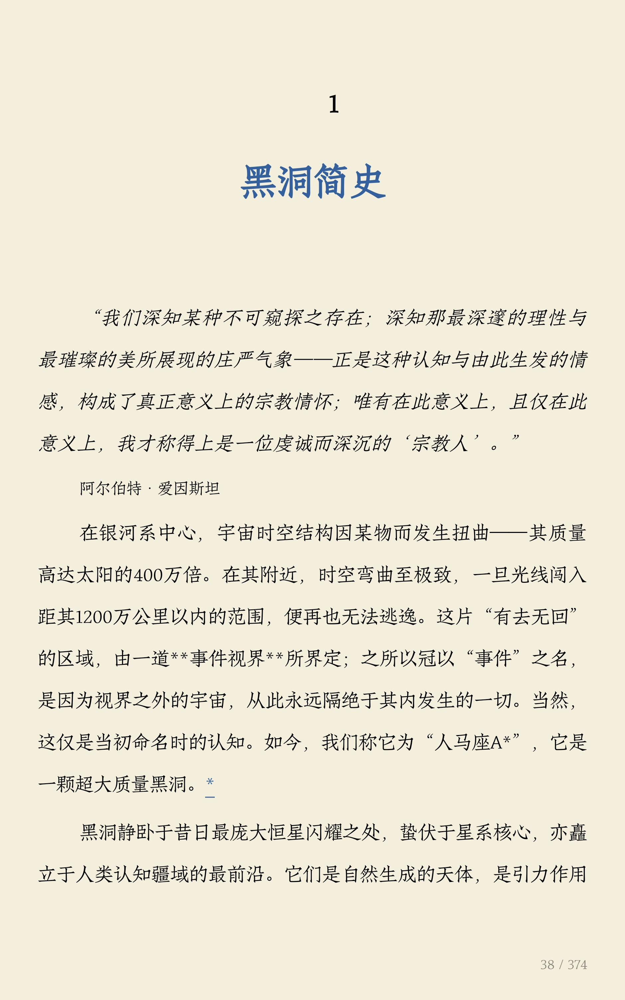

# Wasabi EPUB
[English](./README_en.md) | [中文]

一个面向长文档和字幕场景的命令行翻译工具，支持把 `EPUB`、`HTML`、`PDF`、`SRT` 和带字幕的视频翻译成目标语言，并尽量保留原始结构、章节顺序、目录、版式或字幕轨。

## Demo

字幕示例（原字幕 / 翻译后字幕）：

<p align="center">
  
  
</p>

电子书示例（英文原页 / 中文输出）：

<p align="center">
  
  
</p>

PDF 示例（英文原页 / 中文输出）：

<p align="center">
  
  
</p>

## 支持的输入

- `EPUB`
- `HTML / HTM`
- `PDF`
- `SRT`
- `MKV / MP4 / MOV / M4V / WEBM`

## 主要能力

- 按文件类型自动选择对应工作流
- 翻译前生成 Book Bible，结合 Director、记忆与术语检索保持跨章节一致性
- 通过 Inline Slots 和结构校验保留超链接、行内格式与脚注
- 支持 `Gemini`、`Qwen`、`Mimo`、`OpenRouter` 及 OpenAI 兼容中转站
- 支持章节选择，仅 `EPUB`
- 支持页码选择，仅 `PDF`
- 支持断点续跑，重跑时优先复用缓存
- 支持术语表生成与标题格式标准化
- 支持把视频中的字幕轨提取出来翻译，再封装回输出视频
- `PDF` 模式会尽量保留图片、图形和非正文区域

## 环境要求

- [Node.js](https://nodejs.org/) 20.18.1+
- [npm](https://www.npmjs.com/)
- [Python](https://www.python.org/) 3.10+
- 视频字幕模式需要 `ffmpeg` 和 `ffprobe` 在 `PATH` 中可用
- 如需改善 PDF 中文回填效果，建议系统中安装可用的 CJK 字体

## 安装

先安装 Node 依赖：

```bash
npm install
```

## 配置

模型登记和选型放在 `config/wasabi.local.json`，API Key 放在 `.env`。

先复制模板：

```bash
cp config/wasabi.example.json config/wasabi.local.json
```

在 `.env` 中只保留 Key 和本机设置（Key 名必须与模型条目里的 `apiKeyEnv` 一致）：

```env
QWEN_API_KEY=your_qwen_api_key
OPENROUTER_API_KEY=your_openrouter_api_key

# 可选：
# GEMINI_API_KEY=your_gemini_api_key
# MIMO_API_KEY=your_mimo_api_key
# WASABI_CONFIG=config/wasabi.local.json
```

`config/wasabi.local.json` 中每个模型声明 `sdk`、`baseURL`、`apiKeyEnv`、`modelName`、`concurrency` 和 `timeoutMs`，并在 `selection` 中选择 `primary`、可选的 `fallback`，以及 glossary 默认模型和俄/日专用模型。可参考 [config/wasabi.example.json](./config/wasabi.example.json)。

默认行为：

- 默认源语言：`English`
- 默认目标语言：`Chinese (Simplified)`
- 未创建配置且没有旧配置时，程序会在发起模型请求前报错并提示复制模板

多阶段翻译继续使用统一模型网关。可以在 `selection.stages` 中为 `planner`、`translation`、`director`、`glossary`、`memory`、`critic`、`headings` 指定模型 ID；未指定的阶段使用 `primary`，术语阶段优先使用对应语言的 glossary 模型。`--model <模型ID>` 仅覆盖正文翻译阶段。

`selection.stageFallback` 可为阶段指定候补模型，设为 `null` 可禁用该阶段候补；`selection.stageRequirements` 可要求候补支持 `jsonMode` 或 `reasoning`。模型条目可选 `jsonMode`、`maxOutputTokens` 和 `connection`。相同 SDK、URL 和 Key 变量的模型默认共享连接并发上限；显式 `connection` 可以命名连接组，同组模型的连接参数须一致，并发取组内最小值。`--concurrency` 同时覆盖本次任务的全局和连接并发上限。

JSON 配置默认仅在内容安全错误时使用候补。需要扩大范围时，在 `selection.fallback.onErrors` 中列出 `content_policy`、`model_missing`、`auth`、`network`、`rate_limit` 或 `timeout`；`onContentPolicy: false` 始终禁用内容安全回退。SDK 不额外重试，由网关控制请求重试、超时取消和用量统计。OpenAI 兼容中转的 SSE 响应会被解析，只提取正文；空正文和截断响应不会被当作成功译文。

旧配置仍可使用：显式 `WASABI_MODELS_FILE` 读取旧模型文件；否则优先读取默认 JSON 配置，缺失时兼容 `models.json` 或含 `PRIMARY_PROVIDER` / `PROVIDER` 的旧环境配置，并写入迁移提示。不要同时设置 `WASABI_CONFIG` 与 `WASABI_MODELS_FILE`。旧配置按原来的 fallback 错误类别迁移，建议逐步改用上面的 JSON 入口。

缓存会核对源文件、语言、提示词、模型路由和流程版本。失败或部分完成时保留缓存与日志，续跑只重试未完成节点；只有完整成功且非 debug 才清理。归档遇到同名输入文件时追加序号，保留两份。

PDF 模式可选配置：

```env
# Optional: explicitly choose the Python executable for PDF mode
WASABI_PDF_PYTHON=C:\path\to\python.exe
```

## 用法

基本格式：

```bash
node index.js "input-file" [--chap "<selector>"] [--page "<selector>"] [--from "<lang>"] [--to "<lang>"] [--model "<model-config>"] [--concurrency <n>] [--debug]
```

常见示例：

```bash
node index.js doctor
node index.js setup --pdf

node index.js "book.epub"
node index.js "book.epub" --to "fr"
node index.js "book.epub" --chap "1-3"

node index.js "chapter.html" --to "zh"

node index.js "paper.pdf" --to "zh"
node index.js "paper.pdf" --page "1,3,5" --to "zh"

node index.js "episode.srt" --to "zh"
node index.js "movie.mkv" --from "en" --to "zh"

node index.js "book.epub" --debug
```

参数说明：

- `--chap`：只翻译指定章节，仅 `EPUB`
- `--page`：只翻译指定页码，仅 `PDF`
- `--from`：设置源语言
- `--to`：设置目标语言
- `--model`：只覆盖正文翻译阶段使用的模型 ID
- `--concurrency`：设置并发数，必须为正整数
- `--debug`：保留缓存目录和日志文件，便于排错

环境与安装命令：

- `node index.js doctor`：只读检查 Node、Python、PDF、视频和 API key 环境
- `node index.js setup --pdf`：手动使用选中的 Python 安装 PDF 依赖

## 选择器语法

章节选择 `--chap`：

- `1`
- `1-3`
- `1,3,5`
- `1,1-3`
- `'Blackhole'-'Gravity'`

页码选择 `--page`：

- `1`
- `2-4`
- `1,3,5`
- `1,3-5`

## 语言别名

支持的常用别名：

- `en` / `english`
- `es` / `spanish`
- `fr` / `french`
- `ru` / `russian`
- `zh` / `zh-cn` / `zh-hans`
- `ja` / `jp` / `japanese`
- `ko` / `korean`

## 各模式说明

### EPUB

- 输出为新的 `.epub`
- 会尽量保留目录、章节顺序和原始结构
- 对「单个 XHTML 塞多章」的非标电子书会自动体检并拆分：按 NCX 锚点/章节标题重建章节，锚点随标题迁移，同步重写全书内部链接、NCX 与 HTML 目录，并删除被分片替代的旧文件
- 自动拆分后的章节会参与 `--chap` 编号；编号按 spine 阅读顺序计算（不含目录/索引/参考文献），与 AI 规划顺序无关
- 翻译分阶段执行：正文优先（先积累术语与记忆），前言/后置材料最后
- 保存前会校验全书内部链接（含图片等资源）与 NCX 目录的文件/锚点；存在悬空链接时不会写输出，并保留缓存
- 支持 `--chap`

### HTML

- 输出为新的 `.html`
- 适合单文件网页或导出的 HTML 文档

### PDF

- 输出为新的 `.pdf`
- 使用 Node 做主流程编排，Python 负责提取和回填
- 支持 `--page`
- 会尽量保留图片、矢量图、页眉页脚等非正文区域
- 当前表格检测更偏向论文版式；财报和艺术化表格暂不作为近期优化目标
- Python 环境选择顺序为 `WASABI_PDF_PYTHON` -> `python3` -> `python`

### SRT

- 输出为新的 `.srt`
- 会先解析字幕 cue，再走统一翻译流程

### 视频字幕

- 输出统一为新的 `.mkv`
- 会优先探测内嵌字幕轨，也会识别同目录下的外部字幕文件
- 如果没有显式传 `--from`，会优先用字幕轨语言或字幕文本推断源语言
- 当前只支持文本类字幕轨，不支持图片字幕轨

## 输入、输出与缓存

输入文件可以放在：

- 项目根目录
- `input/`

运行成功后：

- 最终结果写入 `output/`
- 原输入文件会被移动到 `input/`；若 `input/` 已有同名文件，会追加序号保留两份，不会覆盖

非 `--debug` 模式：

- 翻译完整成功时，中间缓存和日志会自动清理
- 若翻译失败或只完成部分节点，会保留 `.cache_*` 和日志，重跑时只补翻译失败的节点
- 全部节点翻译失败时不会写出结果文件；部分成功会写出结果并明确提示未完成的节点

`--debug` 模式：

- 会保留 `.cache_*` 目录
- 会保留 `log/` 下的日志文件

缓存说明：

- 缓存目录带目标语言，且用「源内容摘要 + 源/目标语言 + 翻译规则版本」校验；更换 `--to`、修改原文或升级提示词后不会串用旧译文

典型输出文件名：

- `book_zh.epub`
- `chapter_zh.html`
- `paper_zh.pdf`
- `episode_zh.srt`
- `movie_zh.mkv`

## 常见问题

### 1. PDF 跑不起来

优先检查：

- 是否执行过 `node index.js doctor`
- 是否执行过 `node index.js setup --pdf`
- `python3` 或 `python` 命令是否可用
- 如果你在用自定义环境，是否设置了 `WASABI_PDF_PYTHON`

如果你的 Python 不在默认位置，可以设置：

- `WASABI_PDF_PYTHON`

也可以在运行 PDF 时直接让 Wasabi 尝试安装缺失依赖：

```bash
node index.js "paper.pdf"
```

### 2. 视频字幕模式报错

优先检查：

- 是否执行过 `node index.js doctor`
- `ffmpeg` 和 `ffprobe` 是否已安装
- 是否在命令行里直接执行这两个命令
- 输入视频里是否有可用的文本字幕轨，或同目录是否有外部字幕文件

### 3. 想保留日志和中间文件方便排错

加上：

```bash
--debug
```

## 开发与测试

需要 Node.js 20.18.1+。

```bash
npm ci
npm test              # Node 单测与工作流 fixture
npm run lint
npm run test:python   # 需要 PyMuPDF/pikepdf；缺少 fixture 时自动跳过
```

架构与清理策略见 [docs/architecture.md](./docs/architecture.md)。

## 项目结构

用户通常只需要关心这些目录：

```text
input/    放输入文件
output/   放最终输出
log/      调试日志
src/      程序源码
src/pdf/  PDF 子模块
```

如果你只想使用，不需要理解内部实现；如果你要继续改 PDF 流程，可以从 [src/pdf/README.md](./src/pdf/README.md) 开始看中文说明。
